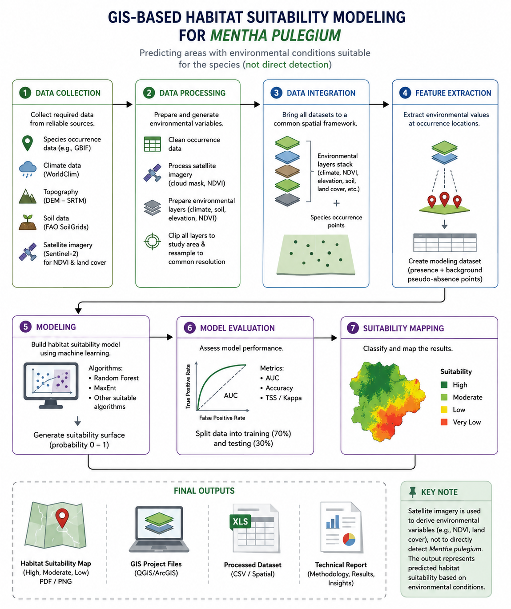
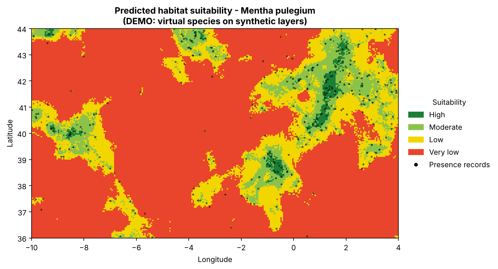
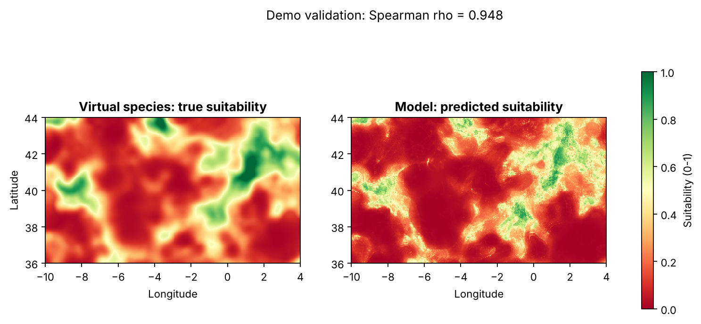
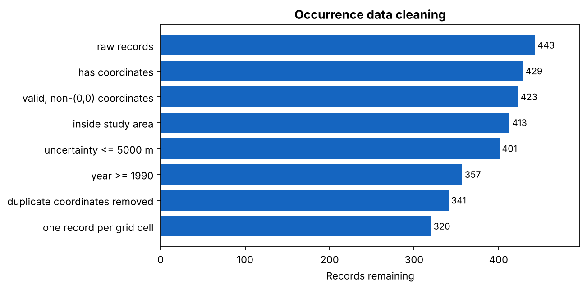
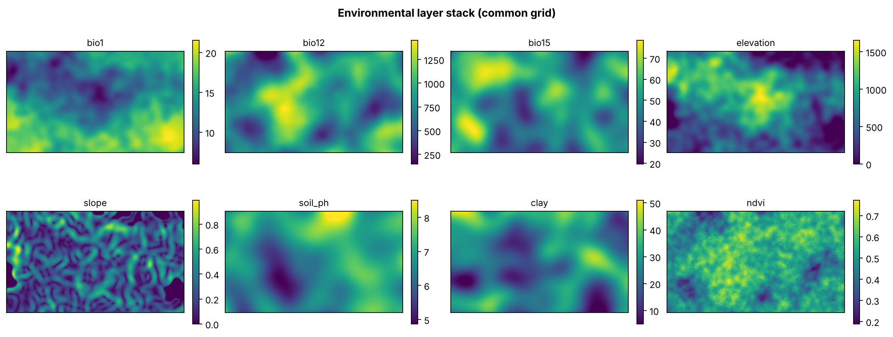
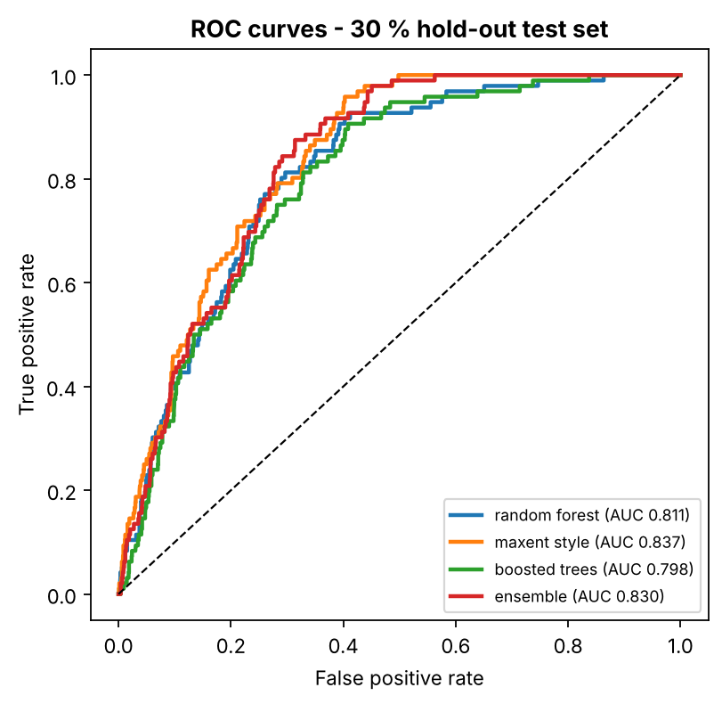
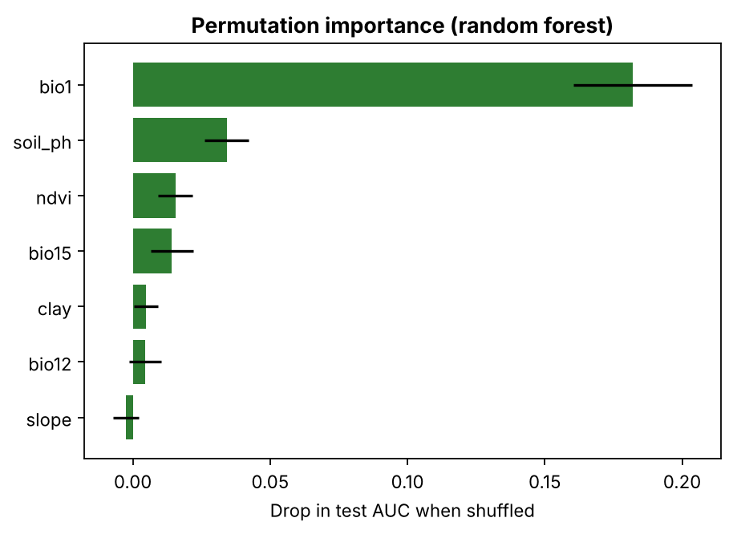
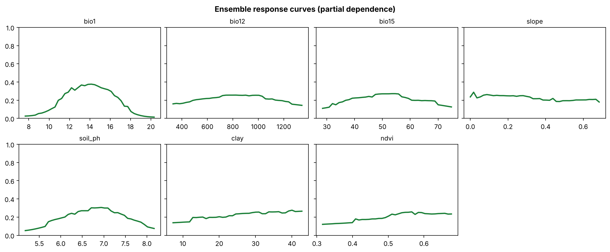
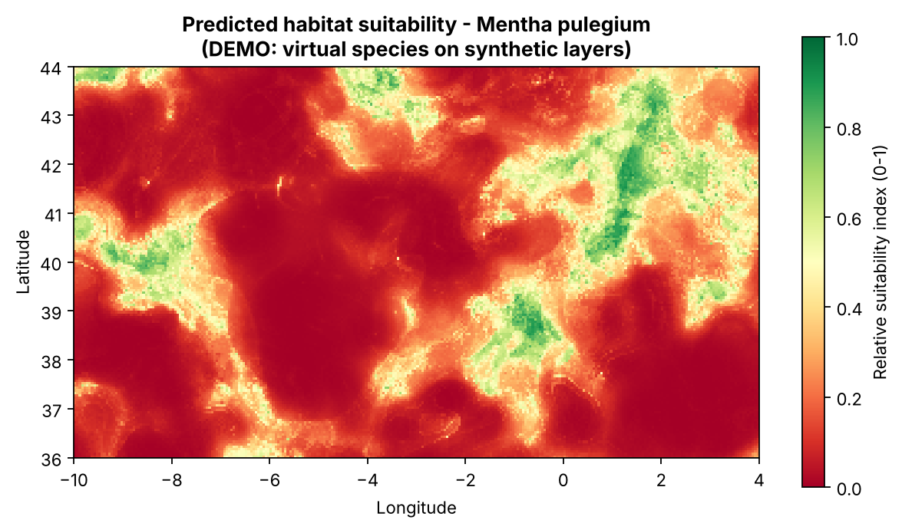

# GIS-Based Habitat Suitability Modelling for *Mentha pulegium*


A reproducible, config-driven Python pipeline that predicts **where environmental conditions are suitable** for a plant species (here, pennyroyal, *Mentha pulegium*) by combining occurrence records, climate, terrain, soil and satellite-derived layers with machine-learning models. It implements the seven-stage workflow below, one module per stage.

> **This is predicted habitat suitability, not detection.** Satellite imagery is used to derive environmental variables (NDVI), never to spot the plant itself. The output is a map of where conditions *could* support the species.

<p align="center">
  
</p>

---

## Read this first: what the included results are

The numbers and maps in this README come from a **demo run on synthetic data**, not from real *M. pulegium* records. The demo builds Iberia-sized environmental layers and a **virtual species** whose niche is defined by me, so the true suitability is known and the pipeline can be checked against it. This proves the code works end to end. It says **nothing** about where pennyroyal actually occurs.

To get real results, run in `real` mode with GBIF records and real WorldClim / SRTM / SoilGrids / Sentinel-2 layers ([instructions below](#using-real-data)). The real-data path (GBIF download, real rasters) is implemented and unit-tested with a mocked API, but **has not been run against live data**.

---

## Demo results

| Model | Test AUC | TSS | Kappa | Boyce | Spatial-block CV AUC |
|---|---|---|---|---|---|
| Random forest | 0.811 | 0.505 | 0.178 | 0.826 | 0.806 ± 0.026 |
| MaxEnt-style (L1 logistic, quadratic terms) | 0.837 | 0.482 | 0.148 | 0.934 | 0.832 ± 0.015 |
| Boosted trees | 0.798 | 0.467 | 0.158 | 0.908 | 0.788 ± 0.024 |
| **Ensemble (mean of the three)** | **0.830** | **0.545** | **0.175** | **0.937** | n/a |

Setup: 443 raw records cleaned to 320 presences, 5,000 background points, 7 predictors, 70/30 stratified split. Ensemble sensitivity 0.84, specificity 0.70.

**Recovery of the known truth:** the predicted surface correlates with the virtual species' true suitability at Spearman ρ = **0.948**.

| Class | Area (km²) | Share |
|---|---|---|
| High | 19,322 | 1.8 % |
| Moderate | 102,046 | 9.6 % |
| Low | 198,829 | 18.8 % |
| Very low | 739,765 | 69.8 % |

<p align="center">
  
</p>

<p align="center">
  
</p>

<details>
<summary>More figures</summary>

| | |
|---|---|
|  |  |
|  |  |
|  |  |

</details>

**Reading these metrics honestly.** Kappa is low (0.15 to 0.18) mainly because presences are only ~6 % of the sample; kappa is prevalence-sensitive, so TSS, AUC and Boyce are more informative here. AUC against random background points is not the same as AUC against true absences, and it tends to be optimistic. The random split is also optimistic for spatially clustered data, which is why spatial-block CV is reported alongside it (it comes out within ~0.01 of the random-split AUC for each model in this demo).

---

## Pipeline

| # | Stage | What it does | Code |
|---|---|---|---|
| 1 | Data collection | GBIF occurrence download (paginated API) or CSV; layer download guide | [`data_collection.py`](src/hsm/data_collection.py) |
| 2 | Data processing | Record cleaning (missing/(0,0)/out-of-area coordinates, uncertainty, year, duplicates, one-per-cell thinning); Sentinel-2 SCL cloud mask + median NDVI composite; clip and resample every layer; slope from DEM | [`processing.py`](src/hsm/processing.py) |
| 3 | Data integration | One `LayerStack` on a common grid with a shared validity mask, saved as a multi-band GeoTIFF | [`integration.py`](src/hsm/integration.py), [`grid.py`](src/hsm/grid.py) |
| 4 | Feature extraction | Sample layers at presences, draw background pseudo-absences, prune collinear predictors (\|r\| > 0.85) | [`features.py`](src/hsm/features.py) |
| 5 | Modelling | Random forest, MaxEnt-style regularised logistic model, boosted trees, and their mean ensemble | [`modeling.py`](src/hsm/modeling.py) |
| 6 | Evaluation | AUC, accuracy, Kappa, TSS, continuous Boyce index on a 30 % hold-out; spatial-block CV; permutation importance | [`evaluation.py`](src/hsm/evaluation.py) |
| 7 | Suitability mapping | Continuous 0-1 surface, four classes (very low / low / moderate / high), area statistics, publication figures | [`mapping.py`](src/hsm/mapping.py) |

`pipeline.py` wires the stages together; `synthetic.py` generates the demo data; `cli.py` is the entry point.

## Quick start

```bash
git clone https://github.com/YOUR-USERNAME/mentha-habitat-suitability.git
cd mentha-habitat-suitability

# Option A: pip (rasterio ships wheels for common platforms)
python -m venv .venv && source .venv/bin/activate
pip install -e ".[dev]"

# Option B: conda
conda env create -f environment.yml && conda activate hsm

hsm run --config config/config.yaml --mode demo    # ~1-2 minutes
pytest                                              # 27 tests
```

Outputs land in `results/` (metrics, tables, figures, GeoTIFFs) and `data/processed/` (cleaned occurrences, layer stack, modelling table).

## Using real data

1. **Set your study area** in `config/config.yaml` (`study_area:` bounding box and `resolution`, in degrees; 0.00833 is about 1 km).
2. **Download the layers** into `data/raw/layers/` and `data/raw/s2_scenes/` following [`docs/DATA_SOURCES.md`](docs/DATA_SOURCES.md) and [`data/raw/README.md`](data/raw/README.md).
3. **Occurrences:** leave `occurrences.source: gbif` to pull records from the GBIF API, or set `csv` and point at your own file.
4. Run `hsm run --config config/config.yaml --mode real`.

For a published analysis, request a GBIF *download* (it gives you a citable DOI) rather than relying on the search API, and replace the demo predictor choice with variables justified by the species' ecology.

## Repository layout

```
├── src/hsm/            pipeline package (one module per stage)
├── config/config.yaml  every tunable choice in one place
├── tests/              27 pytest tests incl. a small end-to-end run
├── docs/               methodology, data sources, QGIS guide, workflow figure
├── results/            metrics.json, tables, figures/, rasters/ (demo run)
├── data/processed/     cleaned occurrences, layer stack, modelling dataset (demo run)
└── .github/workflows/  CI: pytest on Python 3.10 and 3.12
```

## Key methodological choices

Details and reasoning are in [`docs/METHODOLOGY.md`](docs/METHODOLOGY.md). In brief:

- **Outputs are relative suitability indices, not probabilities.** Pseudo-absences make absolute occurrence probability unidentifiable; the 0-1 scale ranks conditions.
- **The "MaxEnt-style" model is not the Maxent program.** It is an L1-regularised logistic regression on linear + quadratic features, a close analogue, named honestly.
- **Classification thresholds are fixed** (0.25 / 0.50 / 0.75) for map legibility; the TSS-optimal threshold used for binary metrics is chosen on cross-validated *training* predictions, so the test set is never used for tuning.
- **Spatial thinning to one record per cell** reduces sampling-bias clustering; it does not remove it.

## Limitations

- Demo results are from synthetic data and are not ecological findings.
- No sampling-bias correction beyond thinning (no target-group background or bias grid).
- Static, present-day conditions only; no climate-change projections or dispersal limits.
- Presence-background design: no verified absences.
- The 5 km demo grid is coarse; microhabitat of a species tied to seasonal wet depressions needs much finer data.
- No QGIS/ArcGIS project file is included; the GeoTIFF outputs open directly (see [`docs/QGIS_GUIDE.md`](docs/QGIS_GUIDE.md)).

## Roadmap

- Target-group background and bias-corrected sampling
- Environmental-extrapolation (MESS) map
- Future-climate projections (CMIP6 WorldClim layers)
- Hyper-parameter tuning with spatial CV

## References

- Allouche, O., Tsoar, A., Kadmon, R. (2006). Assessing the accuracy of species distribution models: prevalence, kappa and the true skill statistic (TSS). *Journal of Applied Ecology*.
- Barbet-Massin, M. et al. (2012). Selecting pseudo-absences for species distribution models. *Methods in Ecology and Evolution*.
- Fick, S.E., Hijmans, R.J. (2017). WorldClim 2: new 1-km spatial resolution climate surfaces for global land areas. *International Journal of Climatology*.
- Hirzel, A.H. et al. (2006). Evaluating the ability of habitat suitability models to predict species presences. *Ecological Modelling*.
- Phillips, S.J., Anderson, R.P., Schapire, R.E. (2006). Maximum entropy modeling of species geographic distributions. *Ecological Modelling*.
- Poggio, L. et al. (2021). SoilGrids 2.0: producing soil information for the globe with quantified spatial uncertainty. *SOIL*.
- Renner, I.W., Warton, D.I. (2013). Equivalence of MAXENT and Poisson point process models for species distribution modeling in ecology. *Biometrics*.
- Valavi, R. et al. (2019). blockCV: an R package for generating spatially or environmentally separated folds. *Methods in Ecology and Evolution*.

## Author

Samson Adeyomoye, GIS Analyst. Released under the [MIT License](LICENSE).
